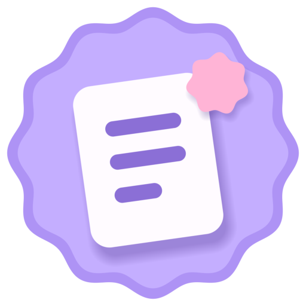
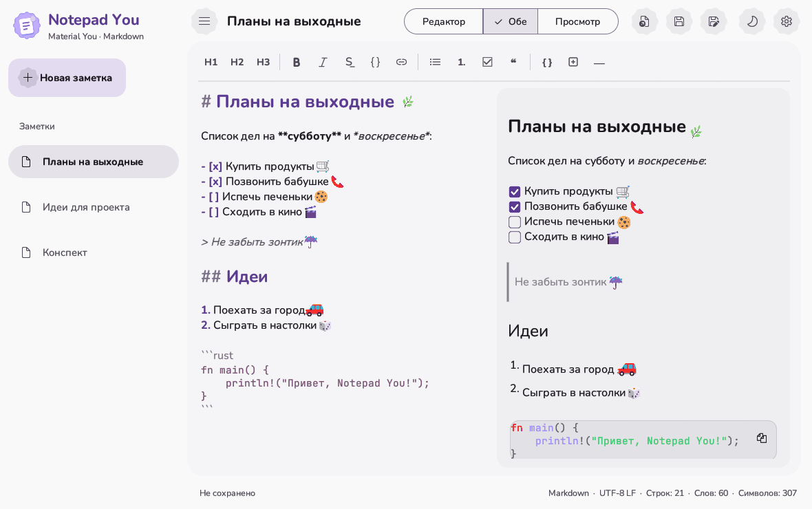
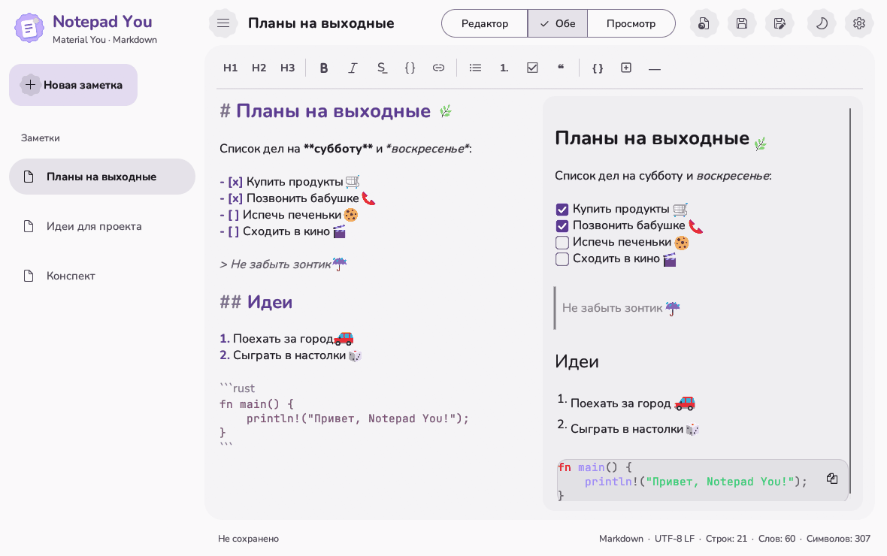
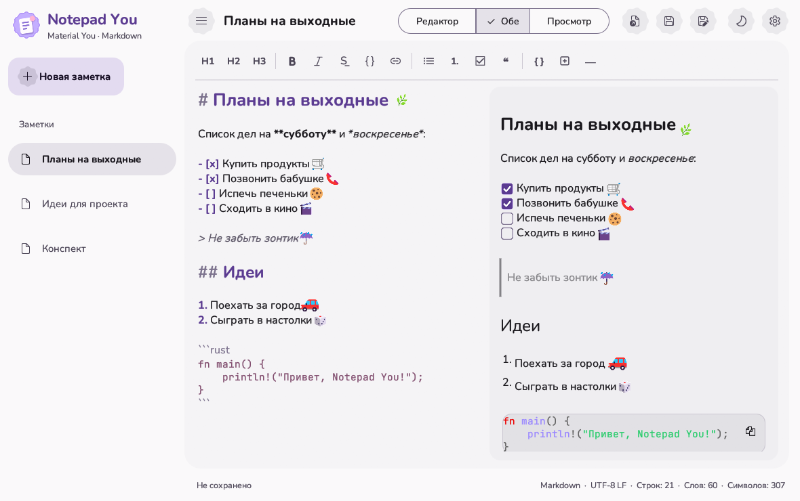
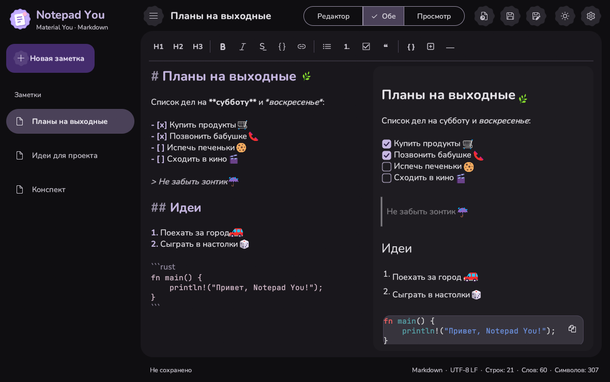
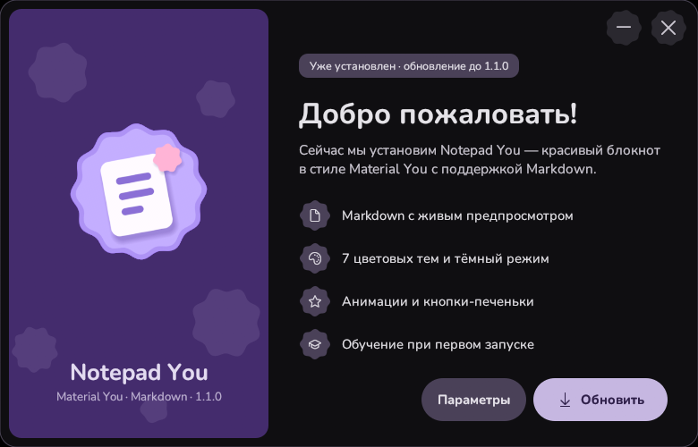

<div align="center">



# Notepad You

**Красивый блокнот в стиле Material You — с Markdown, цветными смайликами и кнопками-печеньками**

[](https://keysliong.github.io/notepad-you/download/NotepadYou-Setup.exe)
[](https://keysliong.github.io/notepad-you/download/NotepadYou.dmg)
[](https://keysliong.github.io/notepad-you/)


[](https://github.com/keysliong/notepad-you-app/actions/workflows/macos.yml)

<br>



<sub>Пишите Markdown слева — справа сразу готовый текст с цветными смайликами и галочками задач</sub>

</div>

---

## ✨ Что умеет

<table>
<tr>
<td width="50%" valign="top">

### 📝 Markdown как надо
Заголовки, **жирный**, *курсив*, списки, задачи, таблицы, цитаты и код.
Подсветка разметки прямо в редакторе и живой предпросмотр рядом.
Три режима: «Редактор», «Обе», «Просмотр».

### 🎨 7 цветовых тем
Лаванда, Коралл, Океан, Мята, Роза, Янтарь и Графит — светлые и тёмные.
Цвета плавно перетекают, а иконка в окне перекрашивается под тему.

### 🍪 Кнопки-печеньки
Фигуры Cookie из Material 3 Expressive: кнопки увеличиваются,
проворачиваются и меняют цвет при наведении.

</td>
<td width="50%" valign="top">

### 😋 Цветные смайлики
Emoji рисуются цветными и в редакторе, и в предпросмотре —
из системного шрифта (Segoe UI Emoji / Apple Color Emoji).

### 🎓 Обучение при первом запуске
Экран затемняется, нужная кнопка подсвечивается, а подсказка говорит,
что нажать. Шаги переключаются сами, когда вы делаете действие.

### ⚡ Лёгкий и быстрый
Около 5 МБ, написан на Rust. Обычные файлы `.md` и `.txt` на вашем диске —
без аккаунтов, облака и интернета.

</td>
</tr>
</table>

---

## 🎨 Темы и настройки

<div align="center">

<br>
<sub>Нажмите на печеньку — всё приложение плавно перекрасится. Тёмная тема — одной кнопкой</sub>
</div>

<br>

<table>
<tr>
<td align="center"><br><sub>☀️ Светлая тема</sub></td>
<td align="center"><br><sub>🌙 Тёмная тема</sub></td>
</tr>
</table>

---

## 🎓 Интерактивное обучение

<div align="center">

<br>
<sub>Подсвеченное «окошко» перелетает от кнопки к кнопке, а карточка подсказывает, что делать</sub>
</div>

---

## 🗂 Заметки и режимы

<div align="center">

<br>
<sub>Заметки появляются и исчезают с анимацией, режимы переключаются плавно</sub>
</div>

---

## 📦 Установка

<table>
<tr>
<td width="55%" valign="top">

### Windows 10 и 11
1. Скачайте **[NotepadYou-Setup.exe](https://keysliong.github.io/notepad-you/download/NotepadYou-Setup.exe)**.
2. Запустите и нажмите «Установить» — права администратора не нужны.
3. Ярлыки появятся в «Пуске» и на рабочем столе.

> Если Windows пишет «Система Windows защитила ваш компьютер» —
> нажмите **Подробнее → Выполнить в любом случае** (у программы нет платной подписи).

Удалить: ярлык «Удалить Notepad You» в «Пуске», «Параметры → Приложения»
или [NotepadYou-Uninstall.exe](https://keysliong.github.io/notepad-you/download/NotepadYou-Uninstall.exe).

### macOS 11 и новее
1. Скачайте **[NotepadYou.dmg](https://keysliong.github.io/notepad-you/download/NotepadYou.dmg)** (Apple Silicon и Intel).
2. Перетащите Notepad You в «Программы».
3. При первом запуске: **Системные настройки → Конфиденциальность и безопасность → Всё равно открыть**.

</td>
<td width="45%" valign="top" align="center">


<br>
<sub>Установщик в том же стиле — с анимациями и волнистым прогрессом</sub>

</td>
</tr>
</table>

---

## ⌨️ Горячие клавиши

| Действие | Windows | macOS |
|---|---|---|
| Новая заметка | <kbd>Ctrl</kbd>+<kbd>N</kbd> | <kbd>⌘</kbd>+<kbd>N</kbd> |
| Открыть | <kbd>Ctrl</kbd>+<kbd>O</kbd> | <kbd>⌘</kbd>+<kbd>O</kbd> |
| Сохранить / как… | <kbd>Ctrl</kbd>+<kbd>S</kbd> / <kbd>Ctrl</kbd>+<kbd>Shift</kbd>+<kbd>S</kbd> | <kbd>⌘</kbd>+<kbd>S</kbd> / <kbd>⌘</kbd>+<kbd>⇧</kbd>+<kbd>S</kbd> |
| Закрыть заметку | <kbd>Ctrl</kbd>+<kbd>W</kbd> | <kbd>⌘</kbd>+<kbd>W</kbd> |
| Жирный / курсив / ссылка | <kbd>Ctrl</kbd>+<kbd>B</kbd> / <kbd>I</kbd> / <kbd>K</kbd> | <kbd>⌘</kbd>+<kbd>B</kbd> / <kbd>I</kbd> / <kbd>K</kbd> |
| Сменить режим просмотра | <kbd>Ctrl</kbd>+<kbd>E</kbd> | <kbd>⌘</kbd>+<kbd>E</kbd> |
| Следующая заметка | <kbd>Ctrl</kbd>+<kbd>Tab</kbd> | <kbd>⌃</kbd>+<kbd>Tab</kbd> |

---

## 🛠 Сборка из исходников

<details>
<summary><b>Windows</b></summary>

Нужны [Rust](https://rustup.rs) (тулчейн `stable-x86_64-pc-windows-gnu`) и MinGW-w64 (WinLibs):

```powershell
winget install Rustlang.Rustup BrechtSanders.WinLibs.POSIX.UCRT
rustup default stable-x86_64-pc-windows-gnu
.\build.ps1
```

Получатся `NotepadYou.exe`, `NotepadYou-Setup.exe` (программа вшита внутрь) и `NotepadYou-Uninstall.exe`.

</details>

<details>
<summary><b>macOS</b></summary>

```bash
bash macos/bundle.sh   # → dist/NotepadYou.dmg (универсальный: Apple Silicon + Intel)
```

Ещё `.dmg` собирается автоматически в [GitHub Actions](https://github.com/keysliong/notepad-you-app/actions/workflows/macos.yml) при каждом пуше в `main`.

</details>

<details>
<summary><b>Как записаны гифки в этом README</b></summary>

В программе есть скрытый демо-режим: он проигрывает сценарий и сохраняет кадры
средствами самого egui (без захвата экрана). Сценарии — в `src/demo.rs`:

```powershell
$env:NPY_DEMO="themes"; $env:NPY_RECORD="кадры"; $env:NPY_SCALE="1"; .\target\release\NotepadYou.exe
```

Настройки и заметки пользователя в демо-режиме не читаются и не сохраняются.

</details>

### Структура проекта

| Путь | Что внутри |
|---|---|
| `src/app.rs` | окно, заметки, диалоги, обучение, горячие клавиши |
| `src/theme.rs` | палитра Material You, 7 тем, шрифты |
| `src/widgets.rs` | печеньки, кнопки, переключатель, сегменты в стиле Material 3 |
| `src/emoji.rs` | цветные смайлики и галочки (растеризация через `swash`) |
| `src/highlight.rs` | подсветка Markdown в редакторе |
| `src/icon.rs`, `build.rs` | иконка-печенька, ресурсы `.exe`, файлы в `icon/` |
| `src/demo.rs` | демо-режим для записи гифок |
| `installer/` | установщик и удалятор для Windows |
| `macos/` | сборка `.app` и `.dmg` |

---

<div align="center">

Сделано на **Rust** и **[egui](https://github.com/emilk/egui)** · шрифты **Nunito** и **JetBrains Mono** (SIL OFL 1.1)

<a href="https://keysliong.github.io/notepad-you/"><b>keysliong.github.io/notepad-you</b></a>

</div>
